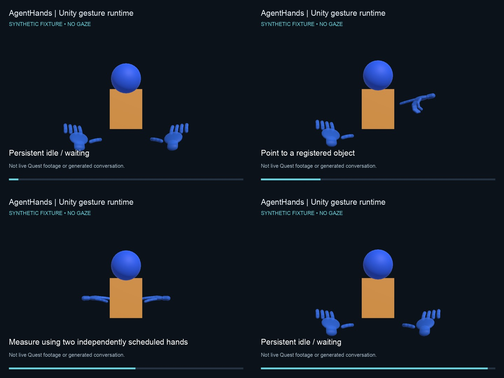
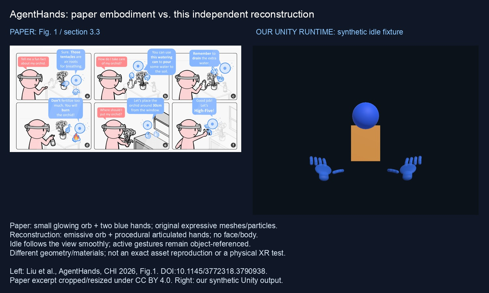

# AgentHands — a no-gaze Quest reconstruction

Independent reconstruction of **AgentHands: Generating Interactive Hand Gestures for Spatially Grounded Agent Conversations in XR**, Liu et al., CHI 2026. [Paper / DOI](https://doi.org/10.1145/3772318.3790938) · [Official project article](https://research.google/blog/agenthands-generating-interactive-hand-gestures-for-spatially-grounded-agent-conversations-in-xr/) · [Authors' reference video](https://www.youtube.com/watch?v=qEtuUv-xizE)

**Not the authors' original source. Gaze is deliberately omitted.** The public fixture uses only synthetic geometry; private room recordings are neither included nor required to run the software tests.



[Watch the public synthetic runtime demo](https://github.com/ryosuzuki/revive/releases/download/agent-hands-v0.1.1/agent-hands-synthetic-demo.mp4) · [Download the public Quest APK](https://github.com/ryosuzuki/revive/releases/download/agent-hands-v0.1.1/agent-hands-public.apk)

## Issue #3 implementation (0.2.0, validation in progress)

The main branch includes persistent orb/two-hand embodiment, idle transitions, a GestureEvent debug panel, and direct Google provider configuration. [Issue #3 setup and key placement](docs/ISSUE-3-SETUP.md) · [Paper comparison and verification](docs/VERIFICATION.md) · [Implementation PR #4](https://github.com/ryosuzuki/revive/pull/4).



The paper excerpt is Liu et al., CHI 2026, Fig.1, cropped/resized under CC BY4.0; DOI10.1145/3772318.3790938. The right-side image is our synthetic runtime, not a room/headset capture. Links to the existing0.1.1 Release below remain the **reference baseline**, not a claim that the0.2.0 APK has passed physical acceptance.

## What it does

- Converts generated paper-style inline gesture markup into shared typed spatial events.
- Registers target geometry with calibrated ray/mesh intersection and semantic regions.
- Schedules independent hands alongside speech and renders articulated 3D hands in Unity.
- Provides a Quest client for spoken object labels, controller-point registration and fresh conversational questions through a configurable backend.
- Supports calibrated replay from recordings you are authorized to use.

## Public media and downloads

The public synthetic fixture demonstrates point, present, measure and rotate behavior using the actual Unity gesture runtime. It is **not a captured room, model-generated conversation, headset recording or physical tracking test**. See `media/` and the paper-tagged [Releases](https://github.com/ryosuzuki/revive/releases) for available downloads. Reference videos linked above belong to the paper authors and are not this implementation's output.

## Quick start: backend and software tests

Run from this folder (`papers/agent-hands`):

```sh
python3 -m venv .venv
.venv/bin/pip install -e .
.venv/bin/python -m unittest discover -s tests -v
export AGENT_HANDS_MODEL_URL=http://127.0.0.1:18441
.venv/bin/python -m uvicorn agent_hands.server:app --host 127.0.0.1 --port 18311
```

Install `ffmpeg` for audio/video conversion. Speech synthesis currently uses macOS `say`; the backend therefore needs macOS for that path. See [model service setup](docs/GPU.md). Configure a private reachable backend for the headset; never expose the unauthenticated research bridge publicly. USB is deployment tooling, not a runtime transport requirement.

## Quest build and controls

Unity **6000.4.5f1** with Android SDK/NDK/OpenJDK; OpenXR 1.16.1, Meta OpenXR 2.5.0, XR Hands1.10.0; ARM64 IL2CPP, Android API32 minimum.

```sh
AGENT_HANDS_APK=/absolute/output/agent-hands.apk \
  /path/to/Unity -batchmode -quit -projectPath "$PWD/unity" \
  -buildTarget Android -executeMethod BuildAgentHands.Android \
  -logFile /absolute/output/build.log
adb -s YOUR_SERIAL install -r /absolute/output/agent-hands.apk
```

The public build is version **0.1.1**, Android versionCode **2**. The package is `org.prlab.agenthands`. Configure `server.json` in the app's persistent-data directory before use:

```json
{"server":"http://YOUR_PRIVATE_WIFI_HOST:18311"}
```

No lab address or credential is built into the public source. After changing the config, relaunch the app. Grant microphone permission. Hold **A** and name an object at the controller position to register it; hold the **right trigger** to ask a question, then release. Connection failure retains the in-memory registry rather than inventing an answer. Persistence across app restart remains unverified.

## Replay your own permitted data

```sh
.venv/bin/python scripts/import_captures.py /private/Archive.zip /private/captures
.venv/bin/python scripts/transcribe.py /private/captures/sessions
.venv/bin/python scripts/generate_replays.py /private/captures/sessions
.venv/bin/python scripts/refine_responses.py /private/captures/sessions
.venv/bin/python scripts/render_replays.py /private/captures/sessions --host YOUR_UNITY_SSH_HOST
.venv/bin/python scripts/package_demos.py /private/captures/sessions /private/demos
```

The remote renderer expects Unity 6000.4.5f1 and the project at `/tmp/openclaw/agent-hands-build`; adapt that generic staging path to your environment. Raw input remains outside source Git.

## Verification and substitutions

See [verification](docs/VERIFICATION.md) and [provenance](docs/PROVENANCE.md).

- Twenty software tests passed on the imported implementation; tests are also run on this public sanitized copy.
- Previous private-context Android builds and replay exports do not establish physical Quest success for this public package.
- Physical installation, fresh headset interaction and alignment accuracy remain unverified.
- Native controller-point registration is a disclosed substitute for the paper's image/mesh semantic registration.
- Speech/gesture alignment is heuristic, not sample-perfect forced alignment.
- The fixture is scripted test data; production responses use the configured model rather than fixture answers.
